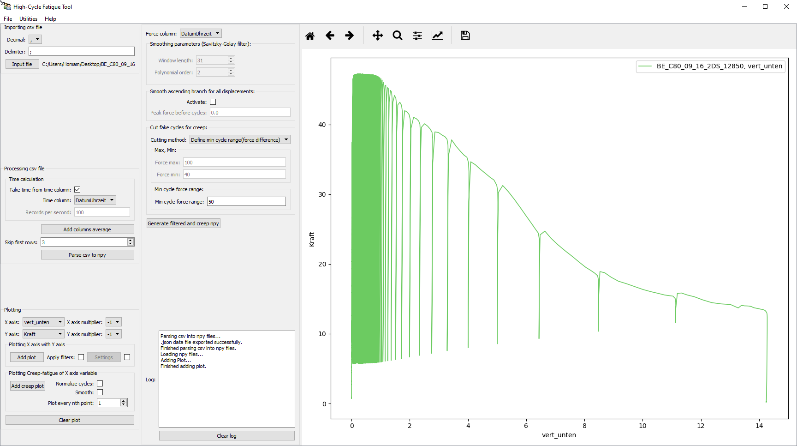
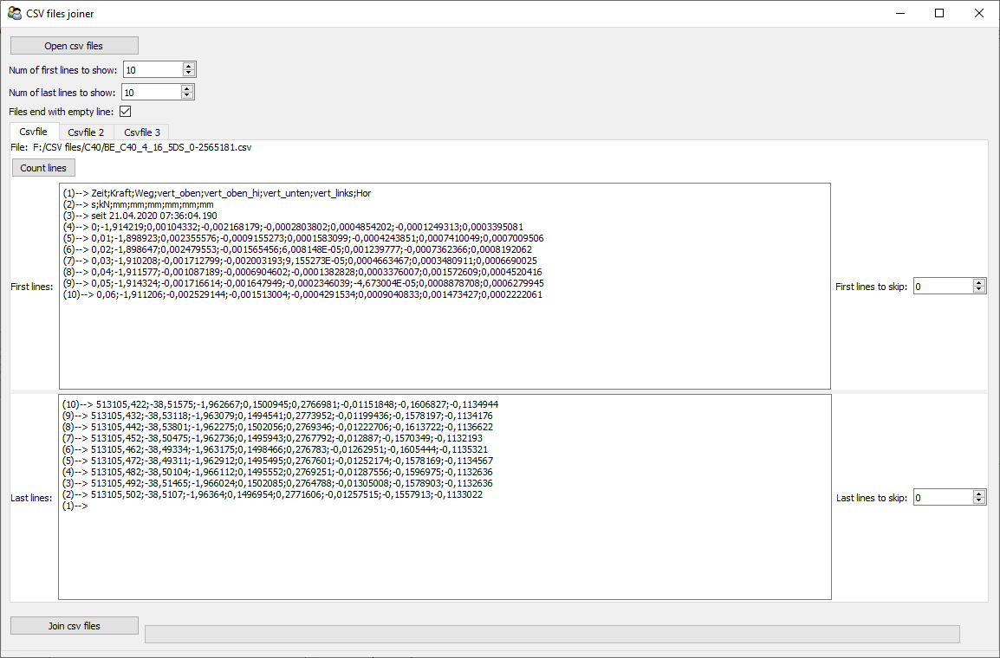

# High-Cycle-Fatigue-Tool (HCFT)
A tool with GUI (Graphical User Interface) for processing CSV files obtained from fatigue experiments up to the high-cycle fatigue ranges. Additionally, tests with monotonic loading can be processed.

## Features:
1. Simple plot functionality for columns of the CSV file.
2. Extracting Max and Min values and filtering the undesired cycles.
3. Extracting and plotting the fatigue creep curve (cycles number vs displacement).
4. Smoothing function for fatigue creep curves.
5. Ability to process file with +20 Gb size.
6. Additional built-in tool for viewing or joining huge CSV (or TXT) files (CSVJoiner).
7. Graphical User Interface with all functions and parameters
8. A headless core, `hcft.cycles`, that turns one cycling step into a table with one row per cycle (numpy only), and a command line, `hcft-table`, for NetCDF files.

## The cycle table without the GUI

`hcft.cycles` needs numpy alone (`pip install hcft` installs nothing else). It gives the GUI its cycles, and other programs can call it directly:

```python
from hcft.cycles import cycle_table, channel_quality, branch_rate

# one cycling step: the time [s], the load (the peak load must be the maximum, e.g. the stress with
# compression positive) and one or more deformation channels in the same sign convention (e.g. the strains)
tab = cycle_table(time, stress, [eps_1, eps_2, eps_3], names=['u1', 'u2', 'u3'], extra=T, extra_names=['T'])

tab.sigma_up, tab.sigma_lo   # the load at the upper and lower turning points, one value per cycle
tab.eps_up, tab.eps_lo       # each channel there: the two branches of the fatigue creep curve
tab.E_sec                    # the secant stiffness per channel and cycle
tab.w_loop                   # the loop's area (dissipated energy) per channel and cycle
tab.regular                  # the cycles of the step's dominant block
channel_quality(tab)         # per channel: follow, still share, third harmonic, jumps, typical values
branch_rate(tab, [3600, 18000, 36000], 1800, covariate='T')   # the branches' rates at 1, 5 and 10 h
```

The core is unit-free: with the stress in MPa and the strain in ‰, `E_sec` is in GPa and `w_loop` in kJ/m³; with the force in kN and the displacement in mm, `w_loop` is the energy per cycle in J (the loop energy of `notebooks/energy_measuring.ipynb`). The method and its checks are described in [dev/concepts/01_THE_CYCLE_TABLE_FOR_REPROXIS.md](dev/concepts/01_THE_CYCLE_TABLE_FOR_REPROXIS.md).

The command line reads NetCDF files (`pip install "hcft[nc]"`) and writes the table as CSV. The variable names are arguments; the factors turn a force and displacements that are negative in compression:

```bash
hcft-table test.nc --load force --channels u_axial_1,u_axial_2 --step-var step_index --load-factor -1 --channel-factor -1 -o table.csv
```

## Installation & usage

### Option 1 (recommended): run from source with [uv](https://docs.astral.sh/uv/)

uv is a fast Python package and project manager. It installs the right Python version and all the dependencies for you, so you don't need Python installed beforehand.

1. **Install uv** (one time only):

   - Windows (PowerShell):
     ```powershell
     powershell -ExecutionPolicy ByPass -c "irm https://astral.sh/uv/install.ps1 | iex"
     ```
   - macOS / Linux:
     ```bash
     curl -LsSf https://astral.sh/uv/install.sh | sh
     ```

   Afterwards, open a new terminal so that the `uv` command is available.

2. **Get the code**:
   ```bash
   git clone https://github.com/bmcs-group/high_cycle_fatigue_tool.git
   cd high_cycle_fatigue_tool
   ```
   (Or download the repository as a ZIP file, extract it and open a terminal in that folder.)

3. **Run the tool**:
   ```bash
   uv run hcft
   ```
   On the first run, uv downloads Python and creates a local `.venv` folder with all the required libraries. Later runs start immediately.

To update to the latest version, run `git pull` and then `uv run hcft` again. uv updates the environment automatically.

<details>
<summary>Other ways to use the tool</summary>

- **With conda**, if you prefer it:
  ```bash
  conda env create -f environment.yml
  conda activate hcft_env
  python main.py
  ```
- **With plain pip**: `pip install ".[gui]"` in the repository folder, then run `hcft`. (`pip install .` alone installs the headless core, `hcft.cycles`, which needs numpy only.)

</details>

### Option 2: Windows installer

- Windows 64-bit: [hcft-1.1.0-win64-setup.exe](https://github.com/bmcs-group/high_cycle_fatigue_tool/releases/download/v1.1.0/hcft-1.1.0-win64-setup.exe)

## For developers

- `uv sync` creates or updates the `.venv` environment from `uv.lock`, with the GUI and the dev tools (the default groups).
- `uv run pytest` runs the tests, `uv run ruff check` the linter.
- `uv add <package>` adds a new dependency to `pyproject.toml` and `uv.lock`.
- `uv build` builds the source distribution and the wheel into `dist/`, and `uv publish` uploads them to PyPI.
- To release a new version, update `hcft/version.py`, build the installer (see below), commit, then run `packaging\windows\release.ps1` to tag the commit and publish the GitHub release with the installer.
- To build the Windows exe and installer, install [Inno Setup 6](https://jrsoftware.org/isinfo.php) and run `packaging\windows\build.bat`. The results are written to `dist\`. See [packaging/windows/README.md](packaging/windows/README.md) for details.
## Cite with: [](https://doi.org/10.5281/zenodo.3603816)
The repository can refered to using a unique doi hosted at https://zenodo.org


## Screenshots:



